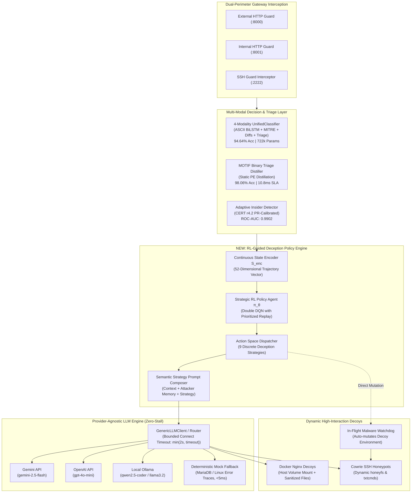

# AdaptiveShield — RL-Guided Adaptive Cyber Deception Module

> **Target Venues**: IEEE Symposium on Security and Privacy (S&P) / ACM Conference on Computer and Communications Security (CCS) / USENIX Security Symposium  
> **Status**: Implementation Plan v3 (Synchronized with `ins` branch & Unified 4-Modality Neural Architecture)  
> **Core Benchmark**: Integrates 94.64% Acc Neural Gateway Classifier + 98.06% Acc MOTIF Binary Triage Distiller (<11ms SLA) + Dual-Perimeter Topology

---

## 1. Executive Summary & Goal

AdaptiveShield replaces the industry-standard static honeypot paradigm (and naive "single-prompt LLM" honeypots like Galah) with an autonomous **Reinforcement Learning (RL) Strategic Deception Policy Engine** decoupled from a **Provider-Agnostic Generative Backend**.

While Web Application Firewalls (WAFs) and IPSs blindly drop malicious traffic—causing attackers to mutate payloads and denying defenders actionable threat intelligence—AdaptiveShield dynamically steers adversarial sessions into high-interaction Docker and Cowrie sandboxes. The RL policy agent determines *what strategic game-theoretic move* to execute (e.g., whether to reveal a vulnerability, drop honeytoken credentials, manipulate response latency, or mutate the file tree upon malware upload), while a pluggable LLM backend (Gemini, OpenAI, Ollama, vLLM, or LiteLLM) synthesizes realistic, context-specific HTTP payloads and system responses with a strict **bounded connect-timeout guarantee ($\le 2.0$s)** and instant fallback.



---

## 2. Evidence Base & Current System Synchronization

The implementation plan is synchronized with the latest codebase commits on `train_1` (including merge commit `f3ea83a` integrating `ins` and `train`):

| Component | Code Location | Status & Empirical Benchmark |
|---|---|---|
| **Unified Neural Classifier** | [`src/agents/decision.py`](file:///home/me/data/AdaptiveShield/src/agents/decision.py), [`src/training/neural/model.py`](file:///home/me/data/AdaptiveShield/src/training/neural/model.py) | **Operational**: 4 input modalities (raw commands, 21-d MITRE ATT&CK, system diffs, 70-d triage). Evaluated: **94.64% test accuracy**, Macro F1 **0.9498**. |
| **MOTIF Binary Distiller** | [`src/core/malware/binary_classifier.py`](file:///home/me/data/AdaptiveShield/src/core/malware/binary_classifier.py) | **Operational**: Distilled from 3,095 real-world malware samples via Ghidra/angr oracle. Evaluated: **98.06% accuracy**, **0.9952 ROC-AUC**, **10.8 ms SLA**. |
| **Adaptive Insider Detector** | [`src/agents/insider/insider_adapter.py`](file:///home/me/data/AdaptiveShield/src/agents/insider/insider_adapter.py) | **Operational**: Evaluated on 330,452 CERT r4.2 user-days. Calibrated F1 optimal threshold $\tau=0.8696$, **0.9902 ROC-AUC**, 99.65% false alarm reduction. |
| **Generic LLM Client** | [`src/honeypot/llm_client.py`](file:///home/me/data/AdaptiveShield/src/honeypot/llm_client.py), [`src/honeypot/router.py`](file:///home/me/data/AdaptiveShield/src/honeypot/router.py) | **Operational**: Provider-agnostic client supporting Gemini, OpenAI, Ollama, vLLM, LiteLLM with a bounded 2.0s connect timeout and safe mock fallback. |
| **Decoy File Engine** | [`src/agents/deception.py`](file:///home/me/data/AdaptiveShield/src/agents/deception.py) | **Operational**: Path sanitization, symlink escape prevention, 100KB file caps, physical file generation into Docker mounts. |
| **Triage Watcher** | [`src/core/triage/watcher.py`](file:///home/me/data/AdaptiveShield/src/core/triage/watcher.py) | **Operational**: Monitors dropped files in decoy downloads directory, runs sub-11ms static triage, and mutates decoy filesystem reactively. |

---

## 3. Formal Problem Formulation: Cyber Deception as an MDP

We model the adaptive cyber-deception defense as a **Partially Observable Markov Decision Process (POMDP)**, operationalized as a continuous-state Markov Decision Process $\mathcal{M} = \langle \mathcal{S}, \mathcal{A}, \mathcal{P}, \mathcal{R}, \gamma \rangle$:

### 3.1 State Space $\mathcal{S} \subseteq \mathbb{R}^{52}$

At each interaction turn $t$ within session $i$, the State Encoder $\mathcal{S}_{\text{enc}}$ constructs a 52-dimensional real-valued vector $\mathbf{s}_t \in \mathbb{R}^{52}$:

$$\mathbf{s}_t = \left[ \mathbf{s}_{\text{intent}} \parallel \mathbf{s}_{\text{mitre}} \parallel \mathbf{s}_{\text{triage}} \parallel \mathbf{s}_{\text{insider}} \parallel \mathbf{s}_{\text{traj}} \parallel \mathbf{s}_{\text{history}} \right]$$

| Sub-Vector | Dimension | Description & Source |
|---|---|---|
| $\mathbf{s}_{\text{intent}}$ | 6 | Softmax posterior distribution across threat classes (`Safe`, `Recon`, `Downloader`, `Exploit`, `Destructive`, `ADVANCED_APT`) from the Unified 4-Modality Neural Model. |
| $\mathbf{s}_{\text{mitre}}$ | 14 | Normalized 14-tactic MITRE ATT&CK occurrence vector reflecting observed adversary techniques (Reconnaissance, Execution, Persistence, Credential Access, etc.). |
| $\mathbf{s}_{\text{triage}}$ | 4 | In-flight malware triage features: $[\mathbb{I}_{\text{has\_binary}}, \mathbb{I}_{\text{is\_malicious}}, \text{Confidence}_{\text{malware}}, \text{FamilyID}_{\text{norm}}]$ generated by the MOTIF Distiller (<11ms). |
| $\mathbf{s}_{\text{insider}}$ | 5 | Insider behavioral risk indicators: $[\mathbb{I}_{\text{is\_internal}}, P_{\text{ML}}, \text{RiskScore}_{\text{norm}}, \mathbb{I}_{\text{scope\_breach}}, \mathbb{I}_{\text{off\_hours}}]$ from the CERT-calibrated engine. |
| $\mathbf{s}_{\text{traj}}$ | 7 | Session trajectory metrics: $[\log(1 + N_{\text{req}}), \text{PathEntropy}, \text{Ratio}_{\text{POST/GET}}, N_{\text{login\_fails}}, \Delta t_{\text{session}}, \Delta t_{\text{inter-arrival}}, \text{PayloadBytes}_{\text{norm}}]$. |
| $\mathbf{s}_{\text{history}}$ | 16 | One-hot previous action $a_{t-1}$ (9-dim), cumulative honeytokens deployed, credentials captured count, fake vulnerabilities exposed count, and sandbox escalation depth (0–3). |

### 3.2 Action Space $\mathcal{A}$ (9 Strategic Deception Actions)

The RL agent selects from 9 discrete, high-level tactical deception strategies $\mathcal{A} = \{0, 1, \dots, 8\}$:

| Action ID | Action Name | Tactical Objective | Operational Realization |
|---|---|---|---|
| **0** | `SERVE_REALISTIC_CLONE` | Build baseline trust during reconnaissance; mask honeypot artifacts. | Clones genuine production HTML/DOM structure using crawled theme without injecting obvious vulnerabilities. |
| **1** | `REVEAL_SYNTHETIC_VULNERABILITY` | Convince attacker an exploit succeeded; isolate attack vector. | Prompts LLM to synthesize realistic MariaDB SQL errors, stack traces, PHP warnings, or reflected XSS payloads. |
| **2** | `SEED_HONEYTOKEN_CREDENTIALS` | Bait attacker into exfiltrating canary assets for attribution. | Injects canary API keys (`sk_live_canary_...`), fake AWS credentials, or staging database credentials into responses. |
| **3** | `ESCALATE_INTERACTIVE_DEPTH` | Keep attacker engaged; unlock simulated high-value surfaces. | Unlocks simulated administrative consoles, staging dashboards, or interactive Cowrie shell capabilities. |
| **4** | `ADAPTIVE_LATENCY_DELAY` | Waste automated scanner resources; test attacker persistence. | Artificially delays HTTP response by $\Delta \tau \in [250\text{ms}, 1800\text{ms}]$ simulating database locking or heavy backend compute. |
| **5** | `EMIT_BREADCRUMB_TRAIL` | Guide adversary toward deeply monitored honeypot subnets. | Embeds HTML comments, robot.txt directives, or fake internal URL hints pointing to secondary decoy services. |
| **6** | `INJECT_TRANSIENT_FAULT` | Probe attacker tooling resilience; assess whether attacker adapts. | Emits authentic HTTP 500/503 errors or gateway connection drops to observe automated retry heuristics. |
| **7** | `DEPLOY_REACTIVE_BINARY_MUTATION` | Neutralize dropper; observe post-execution payloads. | Triggers `watcher.py` to adapt the local filesystem, planting simulated target files matching dropper expectations. |
| **8** | `CONTAIN_INSIDER_SILENT_SANDBOX` | Contain internal threat with zero business disruption. | Serves a synthesized internal intranet view containing watermarked canary documents without alerting the employee. |

### 3.3 Multi-Objective Reward Function $\mathcal{R}$

The reward function mathematically balances four competing objectives: maximizing dwell time ($\mathcal{R}_{\text{dwell}}$), maximizing threat intelligence yield ($\mathcal{R}_{\text{intel}}$), avoiding honeypot fingerprinting / abandonment ($\mathcal{R}_{\text{stealth}}$), and penalizing disruption to benign workflows ($\mathcal{R}_{\text{safety}}$):

$$\mathcal{R}(s_t, a_t, s_{t+1}) = w_1 \mathcal{R}_{\text{dwell}} + w_2 \mathcal{R}_{\text{intel}} + w_3 \mathcal{R}_{\text{stealth}} + w_4 \mathcal{R}_{\text{safety}}$$

$$\begin{aligned}
\mathcal{R}_{\text{dwell}} &= \min\left(1.0, \frac{\Delta t_{\text{interaction}}}{60.0}\right) + \mathbb{I}(\text{session continued}) \\
\mathcal{R}_{\text{intel}} &= +5.0 \cdot \mathbb{I}(\text{honeytoken accessed}) + 3.0 \cdot \mathbb{I}(\text{credential submitted}) + 2.0 \cdot \Delta \text{MITRE\_Techniques} + 4.0 \cdot \mathbb{I}(\text{binary dropped}) \\
\mathcal{R}_{\text{stealth}} &= \begin{cases} -10.0 & \text{if attacker abandons session immediately following } a_t \\ +1.0 & \text{if attacker continues interactive exploration} \end{cases} \\
\mathcal{R}_{\text{safety}} &= \begin{cases} -20.0 & \text{if } a_t \ne 0 \text{ when ground truth is Safe} \\ 0.0 & \text{otherwise} \end{cases}
\end{aligned}$$

*Hyperparameter weights*: $w_1 = 0.30$, $w_2 = 0.35$, $w_3 = 0.20$, $w_4 = 0.15$.

---

## 4. Offline Multi-Persona Attacker Simulator & Training Methodology

To enable reproducible RL training without exposing production infrastructure to live attacks, we implement an **Offline Multi-Persona Attacker Simulator** grounded in real honeypot datasets:

```
                                  ┌──────────────────────────────────────────────┐
                                  │      Attacker Persona Behavior Generator     │
                                  ├──────────────────────────────────────────────┤
[ Public Honeypot Corpora ] ───►  │  • ScriptKiddie (Fast noisy path spraying)   │
• Cowrie SSH Real Logs            │  • AutoScanner (Nikto, SQLMap, Gobuster)     │ ──► [ Simulated Session Episodes ]
• DShield HTTP Telemetry          │  • ManualPentester (Adaptive exploit-driven) │
• MITRE APT1/APT28/APT29 Chains   │  • APTOperator (Stealthy, checks honeypots)  │
                                  └──────────────────────────────────────────────┘
                                                          │
                                                          ▼
                                          ┌───────────────────────────────┐
                                          │ Environment Step & Reward     │
                                          │ S_t ──► Policy π_θ ──► Action │
                                          └───────────────────────────────┘
```

### 4.1 Persona Transition Dynamics
1. **ScriptKiddie**: High drop-off probability if responses are 404/500; easily distracted by fake admin logins (`Action 3`).
2. **AutoScanner**: Deterministic state progression matching Nikto/SQLmap fingerprints; continues testing until payload thresholds are met; vulnerable to artificial delay (`Action 4`).
3. **ManualPentester**: Analyzes error responses; upon observing SQL error traces (`Action 1`), focuses heavily on SQL injection, submitting database exfiltration syntax.
4. **APTOperator**: Actively checks for honeypot indicators (DOM anomalies, unrealistic banner versions); triggers session abandonment if obvious contradictions occur.

### 4.2 Fast Simulation Loop
During the 100,000-episode RL training phase, the LLM is substituted with a **Fast Syntactic Grammar Generator** (running in $<0.2$ms per step). This allows the Deep Q-Network (Double-DQN with Prioritized Experience Replay) to converge in under 25 minutes on standard CPU/GPU hardware.

---

## 5. Architectural Integration with Guard Proxies & Decoy Fleet

### 5.1 Inline Execution Flow (HTTP Guard Interception)
1. **Request Interception**: Incoming HTTP request on `:8000` (external) or `:8001` (internal) parsed into normalized context.
2. **Multi-Modal Inference**:
   - External: `UnifiedClassifier` predicts 6-class intent and extracts 21-d MITRE features.
   - Internal: `AdaptiveInsiderDetector` evaluates user behavior signal against corporate profile.
   - Upload: `BinaryTriageWatcher` checks dropped file with the MOTIF distiller (<11ms).
3. **State Vector Assembly**: `DeceptionStateEncoder.encode()` computes 52-d state vector $\mathbf{s}_t$.
4. **Policy Action Selection**: RL Policy Agent outputs tactical action $a_t = \arg\max_a Q(s_t, a; \theta)$.
5. **Prompt Composition**: `StrategyPromptComposer` maps $a_t$ into structured LLM instructions (e.g., instructing the model to generate a MariaDB syntax error with version string `10.6.12-MariaDB`).
6. **Bounded LLM Generation**: `GenericLLMClient` generates response with a 2.0-second connect timeout and instant fallback to `MockLLMClient`.
7. **Decoy Delivery**: Response is sanitized, baked into Docker Nginx container via `generate_physical_decoy_files()`, and served upstream to the client.

---

## 6. Target File Structure & Module Decomposition

```
src/deception/                                  # NEW: RL-Guided Deception Module
├── __init__.py                                 # Module export interface
├── action_space.py                             # Enum: 9 Strategic Deception Actions & metadata
├── state_encoder.py                            # S_enc: 52-d State Vector Construction
├── reward.py                                   # Multi-objective reward function R(s, a, s')
├── policy.py                                   # PyTorch Double-DQN Architecture (Dueling heads)
├── agent.py                                    # DeceptionAgent runtime controller
├── strategy_prompt_composer.py                 # Maps action ID -> structured LLM instructions
├── attacker_simulator.py                       # Multi-persona environment generator
├── training/
│   ├── __init__.py
│   ├── replay_buffer.py                       # Prioritized Experience Replay (PER)
│   ├── train_rl_agent.py                      # Offline training pipeline (100k episodes)
│   ├── evaluate_agent.py                      # Benchmarking & baseline comparison harness
│   └── ablation_runner.py                     # Systematic component ablation runner
└── data/
    ├── attack_sequences.json                  # Normalized MITRE ATT&CK technique chains
    └── persona_profiles.yaml                  # Probabilistic parameters for attacker personas
```

### Integration Points in Existing Codebase
- [`src/honeypot/generator.py`](file:///home/me/data/AdaptiveShield/src/honeypot/generator.py): Replace hardcoded `PromptBuilder` strategy selection with `DeceptionAgent.select_action()` and `StrategyPromptComposer`.
- [`src/interceptor/http_proxy.py`](file:///home/me/data/AdaptiveShield/src/interceptor/http_proxy.py): Forward state telemetry and in-flight binary triage outputs into the deception engine.
- [`src/core/triage/watcher.py`](file:///home/me/data/AdaptiveShield/src/core/triage/watcher.py): Emit reactive events to the RL agent when binary uploads trigger `Action 7`.
- [`config/settings.yaml`](file:///home/me/data/AdaptiveShield/config/settings.yaml): Add dedicated `deception_rl` configuration section.

---

## 7. Scientific Evaluation Plan for Top-Tier Conference Publication

### 7.1 Baseline Comparisons
We evaluate the RL Policy Agent against four standard deception baselines:
1. **Static-Galah (State-of-the-Art Baseline)**: Deterministic prompting per intent label without trajectory memory (current Galah / DEF CON 32 design).
2. **Heuristic Rule-Engine**: Static rule mapping (e.g., if Recon $\rightarrow$ Serve Page; if Exploit $\rightarrow$ Reveal Error; if Scanner $\rightarrow$ Drop).
3. **Stochastic/Random Policy**: Uniformly random selection across the 9 action candidates.
4. **Omniscient Oracle**: Theoretical upper bound possessing perfect knowledge of the attacker's internal persona.

### 7.2 Evaluation Metrics
- **Mean Adversary Dwell Time ($T_{\text{dwell}}$)**: Total interaction duration (seconds) before session termination.
- **Threat Intelligence Yield ($I_{\text{yield}}$)**: Number of unique MITRE sub-techniques and dropped payloads captured per session.
- **Deception Fingerprinting Rate ($P_{\text{detect}}$)**: Percentage of sessions where adversary identifies honeypot artifacts and terminates connection.
- **Honeytoken Interaction Rate**: Percentage of sessions where deployed canary credentials/tokens are accessed or exfiltrated.
- **Average Processing Latency**: Inline overhead added by state encoding and policy inference (target: $<3.0$ms).

### 7.3 Ablation Studies
1. **Reward Function Component Ablation**: Systematically zeroing out $w_1$ (dwell), $w_2$ (intel), $w_3$ (stealth), and $w_4$ (safety) to prove necessity of each term.
2. **State Modality Ablation**: Removing binary triage features ($\mathbf{s}_{\text{triage}}$) or MITRE features ($\mathbf{s}_{\text{mitre}}$) to measure impact on policy convergence.
3. **LLM Provider Invariance**: Evaluating generation quality, semantic coherence, and response fidelity across Gemini-2.5-Flash, GPT-4o-mini, and local Ollama Qwen2.5-Coder.

---

## 8. Implementation Roadmap & Execution Sprints

- [ ] **Sprint 1: Core State & Action Modeling**
  - Implement [`src/deception/action_space.py`](file:///home/me/data/AdaptiveShield/src/deception/action_space.py) (9 discrete actions, metadata, schema).
  - Implement [`src/deception/state_encoder.py`](file:///home/me/data/AdaptiveShield/src/deception/state_encoder.py) (52-dimensional normalized feature vector).
  - Implement [`src/deception/reward.py`](file:///home/me/data/AdaptiveShield/src/deception/reward.py) (multi-objective reward function).
  - Unit tests: `tests/unit/test_deception_state_reward.py`.

- [ ] **Sprint 2: DQN Policy Network & Training Infrastructure**
  - Implement [`src/deception/policy.py`](file:///home/me/data/AdaptiveShield/src/deception/policy.py) (PyTorch Dueling Double-DQN architecture).
  - Implement [`src/deception/training/replay_buffer.py`](file:///home/me/data/AdaptiveShield/src/deception/training/replay_buffer.py) (Prioritized Replay Buffer).
  - Implement [`src/deception/attacker_simulator.py`](file:///home/me/data/AdaptiveShield/src/deception/attacker_simulator.py) (4 attacker personas).
  - Implement [`src/deception/training/train_rl_agent.py`](file:///home/me/data/AdaptiveShield/src/deception/training/train_rl_agent.py) (offline simulation runner).

- [ ] **Sprint 3: Pipeline Integration & Prompt Composition**
  - Implement [`src/deception/strategy_prompt_composer.py`](file:///home/me/data/AdaptiveShield/src/deception/strategy_prompt_composer.py).
  - Update [`src/honeypot/generator.py`](file:///home/me/data/AdaptiveShield/src/honeypot/generator.py) to integrate `DeceptionAgent`.
  - Connect `watcher.py` binary triage mutations to `Action 7`.
  - Integration tests: `tests/integration/test_rl_deception_pipeline.py`.

- [ ] **Sprint 4: Evaluation, Baselines & Benchmarking**
  - Implement [`src/deception/training/evaluate_agent.py`](file:///home/me/data/AdaptiveShield/src/deception/training/evaluate_agent.py).
  - Run comparative benchmark: RL-Guided vs. Static-Galah vs. Random vs. Heuristic across 1,000 simulated sessions.
  - Generate publication figures and LaTeX result tables.
